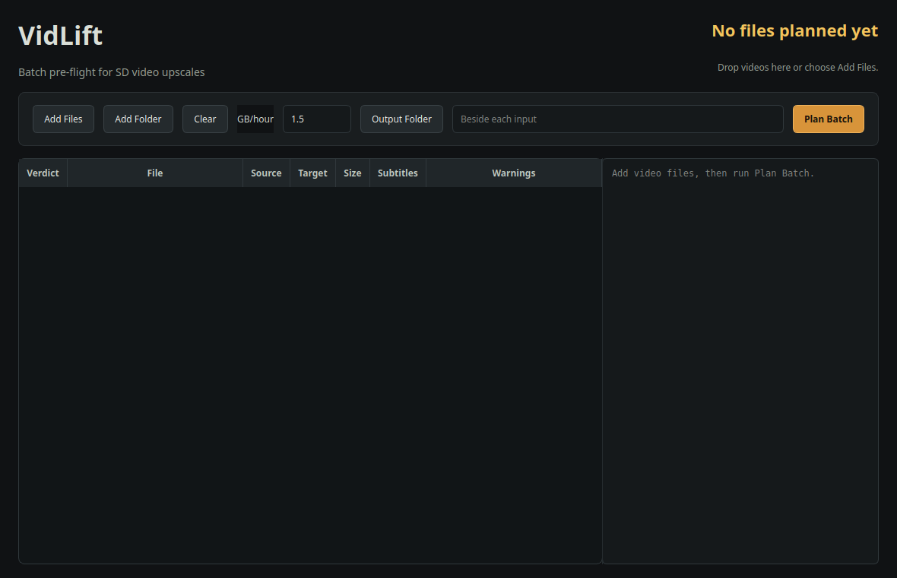
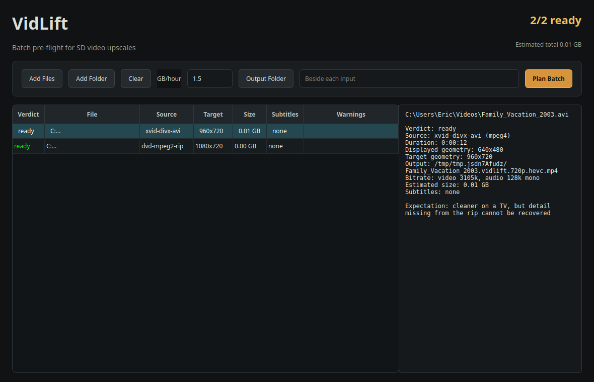
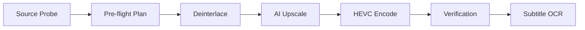

# VidLift

<em>Turn old SD videos into clean 720p HEVC MP4s using local AI upscaling.</em>

[Windows 11] [Vulkan/GPU]

VidLift converts older standard-definition video files into clean 720p HEVC
MP4s using a local Real-ESRGAN ncnn/Vulkan upscale pipeline.

It supports common AVI, DivX, Xvid, MPEG, MP4, MOV, MKV, WMV, FLV, TS, M4V,
and VOB inputs. VidLift probes each file, chooses safe geometry and
deinterlacing behavior, preserves usable audio and subtitles, runs the AI
upscale, encodes the final MP4, and verifies the result.

## Download for Windows 11

1. Open the [latest release](https://github.com/yetisoldier/vidlift/releases/latest).
2. Download **VidLift-<version>-Windows-x64-Setup.exe**.
3. Run the installer.
4. Leave **Create a desktop shortcut** selected if you want quick access.
5. Launch **VidLift** from the Start menu or desktop.

The installer includes VidLift, FFmpeg/ffprobe, Real-ESRGAN ncnn/Vulkan,
the verified x2plus model, and unattended subtitle OCR tools. Python is not
required.

> The installer is currently unsigned. Windows SmartScreen may display an
> **Unknown publisher** warning. The release includes a SHA-256 checksum file
> so you can verify the download.

## ✨ Features
| | |
|---|---|
| **Wide Support** | Upscale AVI, DivX, MP4, MKV, VOB, and more. |
| **Smart Geometry** | Auto-probes source to choose the safest deinterlacing and scaling. |
| **AI-Powered** | Uses Real-ESRGAN ncnn/Vulkan for high-fidelity 720p results. |
| **Subtitle Recovery** | Integrated OCR for bitmap subtitles (VobSub/PGS). |
| **Verification** | Every file is verified after encode to ensure no corruption. |

## 🚀 Quick Start
**You'll need:** Windows 11, Vulkan-capable GPU $\cdot$ **Time:** ~2 minutes

1. Download and run the **Setup.exe** from the [latest release](https://github.com/yetisoldier/vidlift/releases/latest).
2. Launch **VidLift** from the Start menu. ✅ *You should see the main window with "Add Files" options.*
3. Drag a video file into the window. ✅ *The file should appear in the list with "Ready" status.*
4. Select **Plan Batch**. ✅ *You should see the output geometry and estimated size.*
5. Select **Start Upscale**.

Stuck? → [Troubleshooting](#-troubleshooting)

## Plan a batch

Open VidLift, then drag video files into the window or select **Add Files**
or **Add Folder**. Choose an optional output folder, decide whether bitmap
subtitle OCR should run, and select **Plan Batch**.

The plan shows which files are ready, source type, output geometry, exact
output filename, estimated size, subtitle handling, and warnings. Select a row
to see an output preview covering the destination, HEVC video, AAC audio,
subtitles, and estimated size.

Select **Start Upscale** to process every ready file serially. VidLift shows the
current file and completed count while keeping the window responsive. Select
**Cancel Current** to stop safely.

## Run an upscale

Open PowerShell and run:

~~~powershell
$vidlift = "$env:LOCALAPPDATA\Programs\VidLift\vidlift-cli.exe"
& $vidlift run "D:\Videos\movie.avi" --output-dir "D:\Videos\Upscaled" --engine ncnn
~~~

VidLift performs:

1. source probe and classification
2. pre-flight plan
3. deinterlace/prepare when required
4. Real-ESRGAN AI upscale
5. 720p HEVC MP4 encode
6. full verification
7. subtitle pass-through or OCR when possible

## ⚙️ How it works
VidLift automates a complex multi-stage pipeline so you don't have to:

## Bulk upscaling

The OpenClaw/MCP interface accepts multiple paths in one request and queues one
job per file through a single FIFO worker. This prevents multiple upscales from
fighting for the same GPU.

Example request to Jarvis:

> Queue every supported video in D:\Videos\To Upscale through VidLift and
> report when the batch finishes.

The native CLI currently starts one file per command. The desktop GUI and MCP
interface both process bulk queues serially so jobs do not compete for the GPU.

## What you receive

For each successful job, VidLift writes:

- a verified 720p HEVC MP4
- an SRT sidecar when a subtitle was selected or recovered
- a run log with commands, phases, and heartbeat activity
- a JSON manifest with the input, plan, engine, timing, outputs, and
  verification result

Run records are stored in **.vidlift-runs** beside the source unless a different
log directory is supplied.

## ✍️ Subtitle Recovery (OCR)

VidLift includes a built-in pipeline to rescue subtitles from older SD videos. Many legacy formats use "bitmap" subtitles (VobSub from DVDs or PGS from Blu-rays) which are actually images of text that cannot be searched or toggled.

**How it works:**
VidLift uses Optical Character Recognition (OCR) to read these images and convert them into a standard text format. The result is delivered in two ways:
- **Embedded:** The text is muxed into the final MP4 as a `mov_text` track, which is the universal standard supported by VLC, Plex, and Apple TV.
- **Sidecar:** A separate `.srt` file is written next to your output MP4, allowing you to edit the subtitles manually in any text editor.

**The OCR Engine:**
On Windows, VidLift bundles the **Subtitle Edit (seconv)** headless converter and **Tesseract OCR**. It runs a disciplined two-pass process:
1. **Raw OCR:** Tesseract reads the images into a raw SRT file.
2. **Auto-Fix:** A second pass applies common OCR error rules and dictionary-based guessing to resolve common glyph misreads (e.g., replacing a `|` with an `I`).

**Best-Effort / Fail-Open:**
OCR is a "best-effort" service. If a subtitle track is too corrupted or the OCR engine fails, VidLift will **fail open**. This means the video and audio will still be upscaled and saved normally, but the subtitles will be skipped. A subtitle problem will never cause a multi-hour upscale run to be discarded.

**Where to control it:**
In the main window, you can toggle **Enable subtitle OCR**. When enabled, VidLift automatically selects the best available subtitle track (preferring English text over images). In the **Plan** view, you can see exactly which track was selected and whether OCR is required.

## Documentation

- [User guide](docs/usage.md)
- [Desktop interface](docs/ui.md)
- [Command-line reference](docs/cli.md)
- [Troubleshooting](docs/usage.md#troubleshooting)
- [Development](docs/development.md)
- [Architecture](docs/architecture.md)
- [Roadmap](docs/roadmap.md)

## 🔧 Troubleshooting
| Symptom | Likely cause | Fix |
|---|---|---|
| GPU probe failed or driver outdated | Outdated GPU driver | Update your NVIDIA/AMD drivers to the latest version. |
| App crashes on start | Missing Vulkan runtime | Install the latest Vulkan SDK or GPU driver. |
| Output size is too large | High bitrate setting | Check the "Plan" screen; try a different engine if available. |

Full guide → [docs/usage.md#troubleshooting](docs/usage.md#troubleshooting)

## Current limitations

- The CLI runs one file per command; bulk queueing is available through the GUI and MCP.
- GUI progress reports the current file and completed count; detailed phase activity remains in the run log.
- Output target is currently 720p.
- PAL speedup is reported but not corrected.
- Chapters are not preserved.
- OCR is best effort and fails open so a subtitle problem does not discard a
  completed video.

Copyright © 2026 YetiWurks LLC. All rights reserved.
