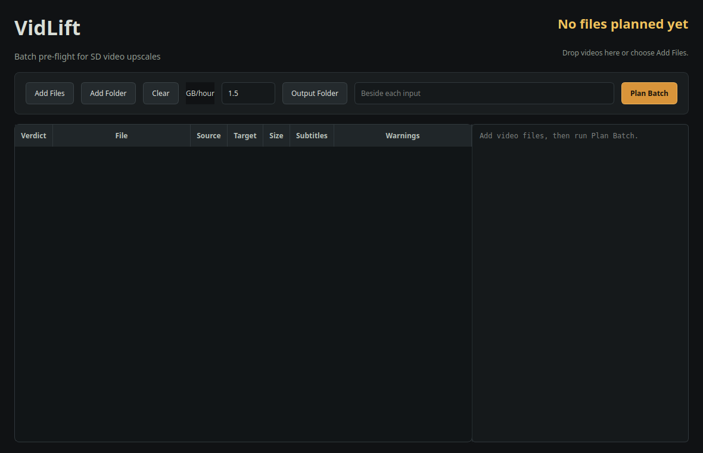
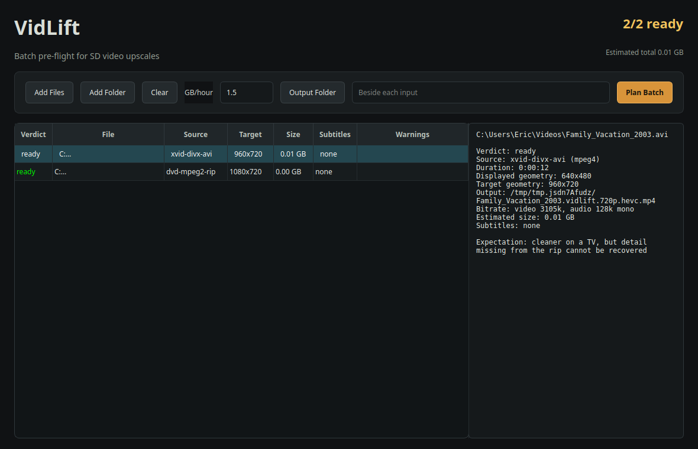
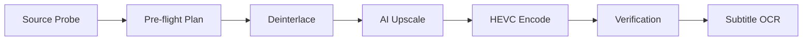

# VidLift

<p align="center"><em>Turn old SD videos into clean 720p HEVC MP4s using local AI upscaling.</em></p>

<p align="center">[Windows 11] [Vulkan/GPU]</p>

VidLift converts older standard-definition video files into clean 720p HEVC
MP4s using a local Real-ESRGAN ncnn/Vulkan upscale pipeline.

It supports common AVI, DivX, Xvid, MPEG, MP4, MOV, MKV, WMV, FLV, TS, M4V,
and VOB inputs. VidLift probes each file, chooses safe geometry and
deinterlacing behavior, preserves usable audio and subtitles, runs the AI
upscale, encodes the final MP4, and verifies the result.

## Download for Windows 11

1. Open the [latest release](https://github.com/yetisoldier/vidlift/releases/latest).
2. Download **VidLift-<version>-Windows-x64-Setup.exe**.
3. Run the installer.
4. Leave **Create a desktop shortcut** selected if you want quick access.
5. Launch **VidLift** from the Start menu or desktop.

The installer includes VidLift, FFmpeg/ffprobe, Real-ESRGAN ncnn/Vulkan,
the verified x2plus model, and unattended subtitle OCR tools. Python is not
required.

> The installer is currently unsigned. Windows SmartScreen may display an
> **Unknown publisher** warning. The release includes a SHA-256 checksum file
> so you can verify the download.

## ✨ Features
| | |
|---|---|
| **Wide Support** | Upscale AVI, DivX, MP4, MKV, VOB, and more. |
| **Smart Geometry** | Auto-probes source to choose the safest deinterlacing and scaling. |
| **AI-Powered** | Uses Real-ESRGAN ncnn/Vulkan for high-fidelity 720p results. |
| **Subtitle Recovery** | Integrated OCR for bitmap subtitles (VobSub/PGS). |
- **Verification** | Every file is verified after encode to ensure no corruption. |
| **Device Tracking** | Live CPU/GPU indicator shows the active transcription device during runs. |

## 🚀 Quick Start
**You'll need:** Windows 11, Vulkan-capable GPU $\cdot$ **Time:** ~2 minutes

1. Download and run the **Setup.exe** from the [latest release](https://github.com/yetisoldier/vidlift/releases/latest).
2. Launch **VidLift** from the Start menu and choose **AI Upscale**.
3. Drag a video file into the window or use **Add Files**.
4. Select **Plan Batch**. ✅ *You should see the output geometry and estimated size.*
5. Select **Start Upscale**.

Stuck? → [Troubleshooting](#-troubleshooting)

For transcription without upscaling, choose **Subtitles Only**, set its options,
add files with **Add Subtitles…** or **Add Folder**, then select **Start Subtitles**.
Adding files stages them for review; switching tabs never starts work. Both tabs
share the queue and results. Checkboxes show an empty square when off and a
visible tick when on, including when disabled during a run.

See [workflow controls](docs/ui.md#controls) and
[replacement, sidecars and recovery storage](docs/usage.md#replacement-sidecars-and-recovery-storage)
before enabling replacement or sidecar suppression.

The standard installer does not bundle NVIDIA CUDA/cuDNN runtime binaries.
GPU transcription is not certified by this release; unavailable CUDA support
is reported with CPU fallback. Vulkan upscaling is a separate engine.

## Plan a batch

Screenshots below show an earlier layout; the current app uses workflow tabs.

Open VidLift, then drag video files into the window or select **Add Files**
or **Add Folder** (folder adds include every subfolder, so a whole show
queues at once). Choose an optional output folder, decide whether bitmap
subtitle OCR should run, and select **Plan Batch**.



The plan shows which files are ready, source type, output geometry, exact
output filename (`<source-name>.720p.mp4` beside the source unless an
output folder was chosen), estimated size, subtitle handling, and warnings. Select a row
to see an output preview covering the destination, HEVC video, AAC audio,
subtitles, and estimated size.



Select **Start Upscale** to process every ready file serially. VidLift shows the
current file and completed count while keeping the window responsive.
Select **Cancel Current** to request cancellation. The built-in transcription
engine runs in a supervised child process with cancellation and timeout handling;
GPU-lock waits also observe cancellation. Publication defers late cancellation
to a safe checkpoint. See the [user guide](docs/usage.md#the-job-appears-stuck).

## Run an upscale

Open PowerShell and run:

~~~powershell
$vidlift = "$env:LOCALAPPDATA\Programs\VidLift\vidlift-cli.exe"
& $vidlift run "D:\Videos\movie.avi" --output-dir "D:\Videos\Upscaled" --engine ncnn
~~~

VidLift performs:

1. source probe and classification
2. pre-flight plan
3. deinterlace/prepare when required
4. Real-ESRGAN AI upscale
5. 720p HEVC MP4 encode
6. full verification
7. subtitle pass-through or OCR when possible

## 📡 Remote monitoring
 
The desktop app serves a small read-only status API while it runs
(LAN monitoring, on by default; the checkbox in the controls area
turns it off). Every response is read-only — the server has no write
verbs and no write surface; it can never enqueue or cancel anything.
 
```bash
curl http://<host>:8765/health                          # token-free liveness: {"ok": true, "busy": ...}
curl "http://<host>:8765/status?token=<token>"         # live queue: api_version 1 + one payload per active job
curl "http://<host>:8765/history?token=<token>"        # finished jobs, newest first
```
 
Authentication: Configure the monitor token in VidLift settings and include it with each request.
  the app's settings file under `[monitor] token=` (QSettings). Treat it as a
  secret and share it only with trusted monitoring clients.
- The server binds `0.0.0.0:8765` by default (overridable via
  `monitor/host` / `monitor/port`); if the port is reserved (Windows
  Hyper-V/WSL port exclusions), the next free port is used and
  persisted.
- `/status` mirrors exactly what the GUI shows, per active job: state,
  current phase, the runner's `progress` dict (`step`,
  `frames_done`/`frames_total`, `chunk_index`/`chunk_total`,
  `phase_note`), the runner's own `log_tail`, and `eta_seconds` only
  when honestly known (a measured benchmark constant on a matching
  engine) — otherwise `null`, never a projection.
- **Discovery & Model Visibility:** The `/status` envelope now includes:
  - A **discovery card** (`monitor.json`) that allows remote agents to
    automatically find the current effective monitor token and port.
  - A **transcription model block** showing the status of the
    `faster-whisper` model (installed, downloading with progress, or
    unknown), allowing watchers to see machine-wide model truth even
    with an idle queue.
- **Discovery & Model Visibility:** The `/status` envelope now includes:
  - A **discovery card** (`monitor.json`) that allows remote agents to
    automatically find the current effective monitor token and port.
  - A **transcription model block** showing the status of the
    `faster-whisper` model (installed, downloading with progress, or
    unknown), allowing watchers to see machine-wide model truth even
    with an idle queue.
  - A **transcription engine block** reporting the readiness of the
    transcription assets and package version.
  - **Device Indicator:** The status payload now includes the resolved
    transcription device (e.g., `GPU (CUDA)`, `CPU`, or `CPU (GPU unavailable)`)
    and the requested device, serving live facts while a job is running.
 
## 🎙️ Audio transcription subtitles

VidLift can create subtitles from a video's own audio when transcription is enabled and no usable text subtitle is selected. It uses the `faster-whisper` medium model; the model is downloaded on demand, verified against a SHA-256 pin, and stored in VidLift's per-user state directory. The first download requires network access. Transcription itself uses the locally installed model.

The **AI Upscale** tab exposes **Transcribe missing subtitles**. **Subtitles Only**
transcribes audio and copies video/audio streams into an MP4 without upscaling;
streams must be MP4-compatible. Existing usable embedded text subtitles are
skipped and existing outputs are blocked. Transcription failure can leave an
upscale completed without generated subtitles, but fails a subtitles-only job.

Model installation is available through the GUI. The monitor/status API reports model and job state; it is not a remote model-install control.
 
## ⚙️ How it works

VidLift automates a complex multi-stage pipeline so you don't have to:



## Bulk upscaling

The OpenClaw/MCP interface accepts multiple paths in one request and queues one
job per file through a single FIFO worker. This prevents multiple upscales from
fighting for the same GPU.

Example request to Jarvis:

> Queue every supported video in <video-folder> through VidLift and
> report when the batch finishes.

The native CLI currently starts one file per command. The desktop GUI and MCP
interface both process bulk queues serially so jobs do not compete for the GPU.

## What you receive

For each successful upscale, VidLift writes:

- a verified 720p HEVC MP4
- an SRT sidecar when a subtitle was selected or recovered, unless
  **Suppress .srt sidecar on success** withholds the public sidecar after a
  verified embed; private subtitle recovery material remains retained
- a run log with commands, phases, and heartbeat activity
- a JSON manifest with the input, plan, engine, timing, outputs, and
  verification result

Run records are stored in **.vidlift-runs** beside the source unless a different
log directory is supplied.

Replacement is opt-in and retains an independent original backup, captured
source and verified candidate in private recovery storage. It is not a disk-space
reclamation option. Inspect the actual output path and warnings: a verified
fallback output does not mean replacement succeeded. Recovery material is not
automatically deleted or replayed.

## ✍️ Subtitle Recovery (OCR)

VidLift includes a built-in pipeline to rescue subtitles from older SD videos. Many legacy formats use "bitmap" subtitles (VobSub from DVDs or PGS from Blu-rays) which are actually images of text that cannot be searched or toggled.

**How it works:**
VidLift uses Optical Character Recognition (OCR) to read these images and convert them into a standard text format. The result is delivered in two ways:
- **Embedded:** The text is muxed into the final MP4 as a `mov_text` track, which is the universal standard supported by VLC, Plex, and Apple TV.
- **Sidecar:** A separate `.srt` file is written next to your output MP4, allowing you to edit the subtitles manually in any text editor.

**The OCR Engine:**
On Windows, VidLift bundles the **Subtitle Edit (seconv)** headless converter and **Tesseract OCR**. It runs a disciplined two-pass process:
1. **Raw OCR:** Tesseract reads the images into a raw SRT file.
2. **Auto-Fix:** A second pass applies common OCR error rules and dictionary-based guessing to resolve common glyph misreads (e.g., replacing a `|` with an `I`).

**Best-Effort / Fail-Open:**
OCR is a "best-effort" service. If a subtitle track is too corrupted or the OCR engine fails, VidLift will **fail open**. This means the video and audio will still be upscaled and saved normally, but the subtitles will be skipped. A subtitle problem will never cause a multi-hour upscale run to be discarded.

**Where to control it:**
In the main window, you can toggle **Enable subtitle OCR**. When enabled, VidLift automatically selects the best available subtitle track (preferring English text over images). In the **Plan** view, you can see exactly which track was selected and whether OCR is required.


## Documentation

- [User guide](docs/usage.md)
- [Desktop interface](docs/ui.md)
- [Command-line reference](docs/cli.md)
- [Troubleshooting](docs/usage.md#troubleshooting)
- [Development](docs/development.md)
- [Architecture](docs/architecture.md)
- [Roadmap](docs/roadmap.md)

## 🔧 Troubleshooting
| Symptom | Likely cause | Fix |
|---|---|---|
| GPU probe failed or driver outdated | Outdated GPU driver | Update your NVIDIA/AMD drivers to the latest version. |
| App crashes on start | Missing Vulkan runtime | Install the latest Vulkan SDK or GPU driver. |
| Output size is too large | High bitrate setting | Check the "Plan" screen; try a different engine if available. |
| A run appears stuck on "running" after it failed | Stale UI state (pre-v0.4.16.1) | Update to v0.4.16.1; failures now settle correctly on all surfaces and report the reason. |
| Transcription fails immediately on a fresh install | Missing VAD assets (v0.4.16.1) | Update to v0.4.16.2. If the issue persists, run `vidlift-cli --selftest` to verify the install. |
| Symptom | Likely cause | Fix |
|---|---|---|
| GPU probe failed or driver outdated | Outdated GPU driver | Update your NVIDIA/AMD drivers to the latest version. |
| App crashes on start | Missing Vulkan runtime | Install the latest Vulkan SDK or GPU driver. |
| Output size is too large | High bitrate setting | Check the "Plan" screen; try a different engine if available. |
| A run appears stuck on "running" after it failed | Stale UI state (pre-v0.4.16.1) | Update to v0.4.16.1; failures now settle correctly on all surfaces and report the reason. |
| Transcription stops with a timeout | Worker did not make progress | Inspect the reported device/fallback reason and run log; the supervised worker is stopped before returning. |
| Transcription fails immediately on a fresh install | Missing VAD assets (v0.4.16.1) | Update to v0.4.16.2. If the issue persists, run `vidlift-cli --selftest` to verify the install. |
| "Resume retained work" is missing or unclickable | Layout overlap (pre-v0.4.17) | Update to v0.4.17.0; a layout overlap that hid the checkbox has been fixed. |

### Transcription Asset Failure
If you are using v0.4.16.1, transcription will fail because the required Silero VAD model was not bundled. Update to v0.4.16.2 to resolve this.

For users on v0.4.16.2+, if transcription fails with a "missing asset" error, you can verify your installation health using the CLI:
~~~powershell
$vidlift = "$env:LOCALAPPDATA\Programs\VidLift\vidlift-cli.exe"
& $vidlift --selftest
~~~
A successful check will return a JSON report and exit with code 0. If it fails, please report the issue with the JSON output.

Full guide → [docs/usage.md#troubleshooting](docs/usage.md#troubleshooting)


## Current limitations

- The CLI runs one file per command; bulk queueing is available through the GUI and MCP.
- GUI progress reports the current file and completed count; detailed phase activity remains in the run log.
- Output target is currently 720p.
- PAL speedup is reported but not corrected.
- Chapters are not preserved.
- OCR is best effort and fails open so a subtitle problem does not discard a
  completed video.
- Source directories must be writable even with a separate output folder;
  read-only-source support is deferred, not a blocker for this release.
- Local filesystem identity, locking and hard-link publication support are
  required. Replacement refuses ambiguous hardlinked sources and unsafe paths.
- Windows directory-entry durability through power loss is not guaranteed.
  Native source-level replacement checks are not GPU, frozen-build or installer
  certification for this combined cycle.

Copyright © 2026 YetiWurks LLC. All rights reserved.
