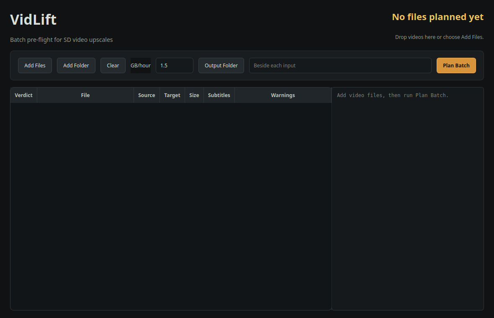
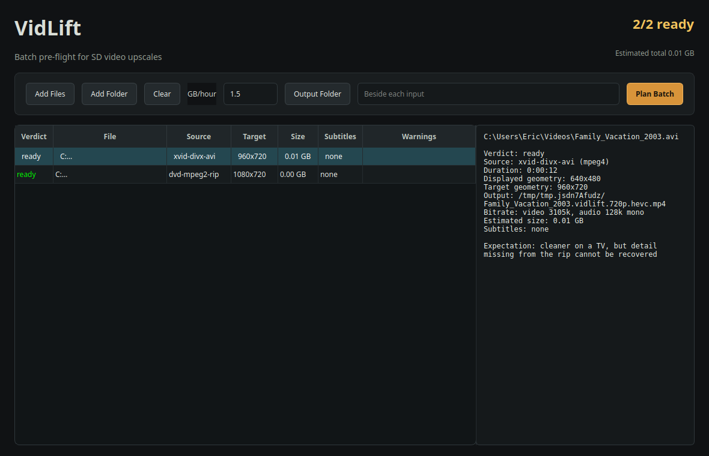

# VidLift Desktop Interface

The desktop app plans and runs batches. It lets you inspect several videos
together before committing GPU hours, then processes ready files one at a time.

v0.4.4: runs are tracked jobs in the SAME persistent registry the
`vidlift mcp-server` uses, so anything an AI agent can see over MCP —
`list`, `status`, `manifest`, and `cancel` — covers GUI-started runs
too. One source of truth, two readers.

## Home screen

A muted helper line above the controls names the canonical order:

> AI Upscale: Add files → Plan Batch → Start Upscale.

For **Subtitles Only**, add and review staged files, then **Start Subtitles**.
Screenshots on this page show an earlier layout, not the current tabs.

### Controls
The settings surface uses **AI Upscale** and **Subtitles Only** tabs, each with
its own options. Switching tabs is presentation only: it does not plan, stage,
submit or cancel work. Queue/results remain shared outside the tabs. Settings
pages scroll when space is limited. Checkboxes show an empty square when off
and a tick when on, including disabled checked states.

**AI Upscale tab**
- **Add Files:** select one or more videos.
- **Add Folder:** recursively add supported videos, including subfolders.
- **Clear:** remove the current list.
- **GB/hour:** set the approximate final size per hour of video.
- **Output Folder:** send every planned MP4 to one destination.
- **Upscale engine:** choose the AI pass. `Auto (recommended)` tries the
  Real-ESRGAN ncnn/Vulkan engine and falls back to the stub when the
  binary, models, or GPU probe fail — recording the exact reason in the
  manifest. `Real-ESRGAN ncnn/Vulkan (GPU)` forces the real engine and
  names a missing setup as an error. `Stub (no AI; encode-only
  fallback)` ships a verified re-encode with no AI pass, on purpose.
  The choice persists across launches; it is fixed while a batch runs
  (cancel to change it).
- **Enable subtitle OCR:** convert selected bitmap PGS/VobSub subtitles to text. Turning this off does not disable ordinary text-subtitle pass-through.
- **Transcribe missing subtitles:** (Default: ON) If no subtitle track is found, VidLift will attempt to generate one from the audio using a local AI model (~1.5 GB).
- **Replace original on success:** opt-in publication at the exact original
  pathname after verification, retaining original bytes in recovery storage.
- **Suppress .srt sidecar on success:** opt-in withholding of the public SRT
  after a verified embed/publication; private subtitle evidence is retained.
- **Resume retained work:** If a previous run was interrupted, this allows VidLift to pick up from the last verified chunk.
- **Plan Batch:** probe and classify every listed file.
- **Start Upscale:** enqueue every ready item as a tracked job.
- **Cancel Current:** stop the running job safely through the same
  cancel path an MCP agent uses; it can take a few seconds while the
  engine exits. Built-in transcription has supervised worker cancellation and
  timeouts; GPU-lock waits are cancellable. Late cancellation during publication
  is deferred to a safe checkpoint, not used to undo a committed output.

**Subtitles Only tab**
- **Add Subtitles… / Add Folder:** check and stage videos, with recursive folder
  collection. Set options before adding: staged rows retain those options.
- **Transcription device:** select the requested transcription device.
- **Start Subtitles:** recheck and submit eligible staged files, not just the
  selected row. Adding files alone does not start jobs.
- **Remove selected staged / Clear staged subtitles:** remove staged choices
  without deleting media or cancelling submitted jobs.
- **Replace original on success (deletes source):** opt-in publication at
  **{stem}.mp4** beside the source; original bytes are retained, not erased.
- **Suppress .srt sidecar on success:** independent of the upscale option;
  withholds the public SRT only after verified embedding/publication.
- **Scope:** This mode adds subtitles from the file's own audio — video streams are copied without re-encoding or upscaling.
- **Pre-flight Skip:** To prevent unnecessary runs, VidLift now checks files at the pick stage. Files that already carry a usable text subtitle track are marked as `skip — already has subtitles` and are not enqueued. Files whose output already exists are marked as `blocked — subtitles output already exists` and are not enqueued. These static rows are rendered in the table for visibility but do not become active jobs.

Files can also be dragged into the window.

Folder collection and GUI submissions are limited to 500 files per batch;
VidLift-generated **.subs.mp4** outputs are excluded from recursive collection.
See [replacement, storage and supported limits](usage.md#replacement-sidecars-and-recovery-storage)
for collision handling, retained backups/journals and writable-source requirements.

## Planned batch

The top-right summary shows the ready count and estimated combined output size.

The table shows:

- verdict
- source path
- detected source class
- target geometry
- exact output destination
- estimated output size
- subtitle disposition
- warnings

Select any row to read the complete file-level plan and output preview in the
right pane. The preview lists the destination filename, HEVC video geometry and
bitrate, AAC audio, subtitle disposition, and estimated size.

## Run panel

After **Start Upscale** a run card appears with:

- the current **stage label** naming what is actually running (probe,
  prepare, `upscaling — frames X/Y`, encode, verify full decode,
  subtitles), driven by the runner's own phase and step facts. For transcription-family
  phases, the label now appends the resolved device (e.g., ` — GPU (CUDA)` or
  ` — CPU (GPU unavailable)`) once known;
- an animated activity-dots indicator plus the elapsed timer, so a
  legitimate 0% window (GPU probe, first chunk) never reads as frozen;
- a **Current file** bar with a measured ETA when the benchmark cache
  has a constant for this geometry bucket (duplicate progress lines
  never blank the ETA; no measured constant means "estimating", never
  a fake percentage);
- a **Device indicator** in the live detail overlay showing the current
  transcription device (e.g., `GPU (CUDA)`, `CPU`, or `CPU (GPU unavailable)`).
  Before resolution, it shows `auto — resolving…` or `auto (requested)`.
- an **Overall queue** bar across every enqueued job;
- a read-only **log tail** rendered from the runner's own log; the
  full log stays in `.vidlift-runs` beside each source file;
- the head **Total remaining** estimate across the whole batch, shown
  only from measured constants and the live ETA. When a file ahead has
  no measured constant the honest reading is "…", never a guess.

Jobs run strictly one at a time. A five-file start is five serial
tracked jobs; Start re-enables when the last one reaches a finished
state. Cancelled, failed, and succeeded jobs all remain in the
registry history and resurface on the next launch (a window closed
mid-run surfaces as `failed` with the restart error — never a silent
"succeeded").

Fail-open parity: when the AI pass fails mid-run (or the plan chose the
stub), the output row reads "completed (no AI upscale)" — the manifest
and the MCP `status` payload carry the same honesty fields the CLI
shows.

## Monitor via MCP

The GUI and MCP use the same persistent job registry. Registry reads refresh
when its file changes; an MCP server need not be restarted merely to discover
GUI-submitted jobs. Use **list**, **status** and **manifest** to inspect recorded
jobs. Detailed live telemetry depends on the owning process; the GUI's read-only
LAN monitor exposes its live status. A persisted job record alone is not proof
that its worker is still running.

The registry lives in one state directory per machine
(`$VIDLIFT_STATE_DIR/jobs.json`, default `~/.vidlift` in development
and the per-platform app-data dir in packaged builds); the stdio
server runs against the same files, and nothing in the GUI
duplicates its state.