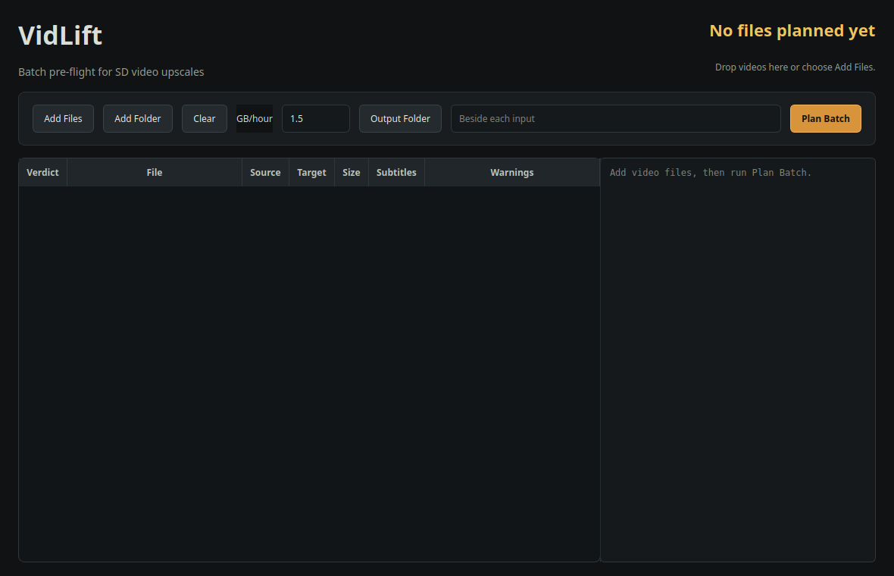
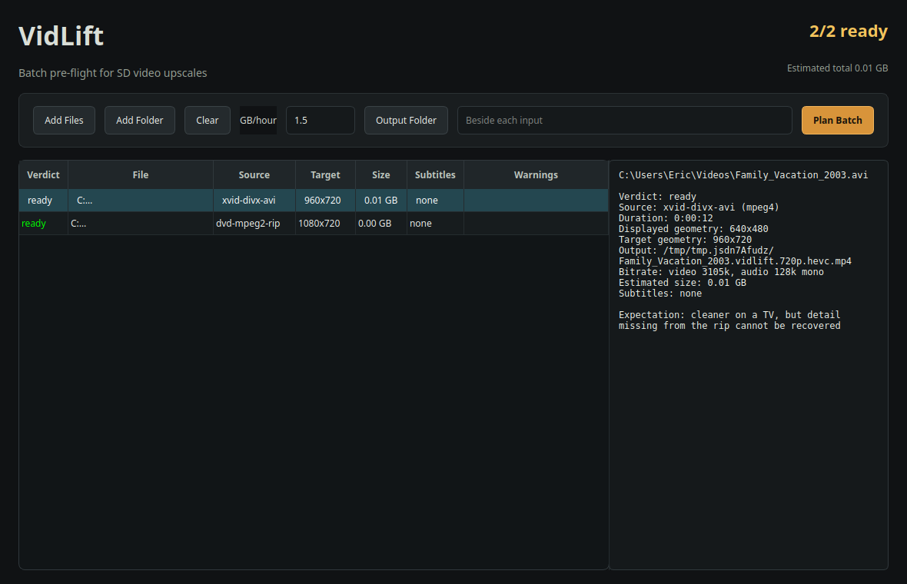

# VidLift User Guide

## 1. Install on Windows 11

1. Open the [latest GitHub release](https://github.com/yetisoldier/vidlift/releases/latest).
2. Download **VidLift-<version>-Windows-x64-Setup.exe**.
3. Optionally download the matching **.sha256** file.
4. Run the setup program and accept the default per-user install location.
5. Launch VidLift from the Start menu.

VidLift installs under:

    %LOCALAPPDATA%\Programs\VidLift

The installer includes every runtime dependency. You do not need Python,
FFmpeg, Real-ESRGAN, Subtitle Edit, or Tesseract separately.

### SmartScreen notice

The installer is not yet Authenticode-signed. Windows may show **Windows
protected your PC** or **Unknown publisher**.

To continue, select **More info**, confirm the filename matches the GitHub
release, and select **Run anyway**.

### Verify the installer checksum

In PowerShell:

~~~powershell
Get-FileHash .\VidLift-0.4.3-Windows-x64-Setup.exe -Algorithm SHA256
Get-Content .\VidLift-0.4.3-Windows-x64-Setup.exe.sha256
~~~

The two hexadecimal hashes must match exactly.

## 2. Plan files in the desktop app

Launch VidLift and select **AI Upscale** or **Subtitles Only**. Each tab keeps
its own options; both share the queue, details and results. Changing tabs does
not plan, stage or submit files. Checked options display a tick; unchecked
options display an empty square, with checked state still visible when disabled.
The screenshots below show an earlier layout; use the current tab labels.

### Add source videos

Use any of these methods:

- drag one or more video files into the window
- select **Add Files**
- select **Add Folder** to add supported videos from one folder, including
  every subfolder (recursion is always on — a whole show, all seasons,
  queues at once; dropping a folder does the same walk)

Recognized extensions include AVI, DivX, FLV, M4V, MKV, MOV, MP4, MPEG,
MPG, TS, VOB, and WMV.

### Set the output size target

**GB/hour** controls the approximate final file size. The default is 1.5 GB
per hour. A two-hour video would therefore target roughly 3 GB.

Higher values preserve more encode detail but create larger files. This setting
does not change the 720p output geometry.

### Choose an output folder

Select **Output Folder** if every planned MP4 should go to one destination.
Leave it empty to place each output beside its source.

### Run the AI Upscale pre-flight plan
Choose whether **Enable subtitle OCR** should remain on, then select **Plan Batch**.

Replacement and sidecar suppression are separate, opt-in settings in each tab.
See [replacement, sidecars and recovery storage](#replacement-sidecars-and-recovery-storage).

The table reports:

- **Verdict:** ready or skipped
- **File:** source path
- **Source:** detected source class
- **Target:** planned output dimensions
- **Output:** exact destination filename
- **Size:** estimated final size
- **Subtitles:** selected subtitle handling
- **Warnings:** interlace, PAL-speedup, or other cautions

Select a row to see the complete explanation and output preview in the details
pane. The preview includes the destination, HEVC video, AAC audio, subtitles,
and estimated size.

Select **Start Upscale** to process every ready item serially. The progress bar
shows the completed count and current file. Select **Cancel Current** to stop
the active file. Built-in transcription runs in a supervised child process so
cancel and timeout handling can stop a stuck engine. Model preparation and
GPU-lock waits also observe cancellation. Once media publication starts, late
cancellation is deferred to a safe checkpoint; it does not undo a committed output.

### Subtitles Only

1. Select **Subtitles Only** and choose the transcription device, replacement
   and sidecar options before adding files. Options are captured when files are added.
2. Use **Add Subtitles…**, **Add Folder** (recursive), or drop videos onto this
   workflow. Files are checked and staged, not immediately submitted.
3. Review the rows. Already-usable embedded text subtitles are skipped; an
   existing subtitles output is blocked. Bitmap tracks and external SRT files
   do not count as embedded text for this skip. CLI **--force** overrides only
   the subtitle-presence check, never an output collision.
4. Use **Remove selected staged** or **Clear staged subtitles** to correct the
   selection, then **Start Subtitles** to submit eligible staged files.

This workflow transcribes the file's audio and copies video/audio into
**{stem}.subs.mp4**, embedding toggleable text subtitles. It does not upscale,
re-encode video/audio, or perform bitmap OCR. The source must contain audio and
its copied streams must be MP4-compatible; unsupported remuxes fail rather than
silently re-encoding. Existing bitmap subtitles and other non-mapped streams
are not carried into this output. A transcription/remux failure fails this job
and retains available diagnostic/subtitle material.

### Replacement, sidecars and recovery storage

- Both **Replace original on success** and **Suppress .srt sidecar on success**
  default off and are independent in each workflow.
- Without replacement, AI Upscale normally publishes **{stem}.720p.mp4** in the
  chosen output folder or beside the source. Subtitles Only publishes
  **{stem}.subs.mp4** beside the source, irrespective of the upscale output folder.
- With replacement, AI Upscale publishes MP4 bytes at the exact original
  pathname, even if its extension is not **.mp4**. Subtitles Only instead uses
  **{stem}.mp4** beside the source. On successful replacement the old source
  pathname is retired, but original bytes are retained in recovery storage.
  Failed upscale transcription prevents source retirement.
- A verified candidate and source identity/content checks precede replacement.
  An independent original backup is made before capture. An unrelated target is
  never intentionally overwritten. Sharing violations, changed sources or late
  collisions can retain output at a fallback or private path with warnings.
  Read the actual output path and recovery notes, not just the job's success
  state: a verified fallback is not confirmation that replacement succeeded.
- Suppression withholds the public SRT only after embedding and publication
  have been verified. It does not burn subtitles into the picture or remove
  private subtitle evidence. Failed embedding keeps an available SRT as fallback.
  Existing sidecars are not overwritten; if publication is refused, the result
  reports the retained private SRT path.
- Private **.vidlift-media-*** directories beside sources retain candidates,
  subtitle material and **journal.json**; replacement also retains
  **original.backup** and, when captured, **original.captured**. Cross-device
  output staging can create **.vidlift-media-output-*** beside the destination.
  These are separate from ordinary scratch cleanup and remain indefinitely.
  Budget for an additional full independent original copy plus retained original
  and output/staging material, not just the final MP4. Suppression and replacement
  are not disk-reclamation features; retained links may share storage, so there
  is no fixed disk-space multiplier.
- Inspect output and recovery paths before manually removing recovery material.
  There is no automatic journal replay or recovery cleanup. An incomplete
  transaction affecting the same paths can block another attempt pending inspection.

Sources must be in writable directories even when a separate output folder is
selected and replacement is off. Read-only-source support is explicitly deferred,
not a blocker for this release. Local stable file identity, locking and hard-link
publication support are required. Replacement refuses hardlinked sources;
symlink/reparse paths and unsafe parent directories can also be refused.

On Windows, disposable local capture/publication checks run before processing.
Directory-entry durability through power loss is not guaranteed. Native
source-level fixture validation is not certification of GPU/model quality,
frozen executables, installers or crash/power-loss recovery for this cycle.

## 3. Run one file from PowerShell

Open PowerShell and define the installed CLI path:

~~~powershell
$vidlift = "$env:LOCALAPPDATA\Programs\VidLift\vidlift-cli.exe"
& $vidlift --version
~~~

Run a real AI upscale:

~~~powershell
& $vidlift run "D:\Videos\movie.avi" --output-dir "D:\Videos\Upscaled" --engine ncnn
~~~

Use quotes around paths containing spaces.

### Useful run options

- **--gbph 1.5** sets the approximate output size per hour.
- **--output-dir PATH** writes the final MP4 to a chosen folder.
- **--log-dir PATH** puts logs and manifests in a chosen folder.
- **--engine ncnn** requires the real AI engine and reports a clear error if it
  cannot start.
- **--engine auto** uses ncnn when its GPU probe succeeds; otherwise it records
  the fallback honestly.
- **--engine stub** deliberately skips AI and is intended for pipeline testing.

### Denoise (v0.4.15)

`--denoise light|strong` (GUI: "Denoise source before upscaling") adds a
denoise pass to the video preparation step, BEFORE the AI upscale.

**When to use it:** noisy analog sources — VHS-grade rips, old tape
transfers, heavy film grain or snow, noisy broadcast captures. A denoise
pass on these gives the upscale model a cleaner signal, and the result
is visibly better than upscaling the noise (upscaling amplifies tape
noise as much as it amplifies detail).

**When NOT to use it:** clean digital sources — DVD and Blu-ray rips,
modern captures. The upscale model already softens light grain on its
own, so denoising a clean source only costs fine detail for no gain.
When in doubt, leave it Off.

`light` suits most noisy tapes. Use `strong` only when noise is still
clearly visible in the result of a `light` run — `strong` softens the
picture noticeably. The pass adds almost no time compared to the
upscale itself (seconds per minute of video, vs. minutes for the
upscale). The setting is manual: VidLift does not try to detect noisy
sources automatically.

## 4. Queue a bulk upscale

VidLift's MCP interface accepts multiple input paths. It creates one job per
file and processes them FIFO through a single worker so the jobs do not compete
for the GPU.

Example request to Jarvis:

> Queue every supported video in D:\Videos\To Upscale through VidLift. Use
> D:\Videos\Upscaled for output and notify me when the batch finishes.

You can also provide an explicit list of files. Jarvis can plan the batch,
start it, report status, cancel a job, and inspect each final manifest.

The installed CLI currently starts one file per command. The GUI and MCP
interface both run bulk queues serially so jobs do not compete for the GPU.

## 5. Understand the pipeline

Each job passes through these phases:

1. **Probe:** inspect streams, geometry, frame rates, duration, and subtitles.
2. **Plan:** choose output geometry, bitrate, subtitle disposition, and warnings.
3. **Prepare:** deinterlace, inverse-telecine, or normalize the source as needed.
4. **Upscale:** process source frames through Real-ESRGAN ncnn/Vulkan.
5. **Encode:** write a 720p HEVC MP4 with audio.
6. **Verify:** inspect the container, geometry, duration, and full decode.
7. **Subtitles:** pass text subtitles through or attempt OCR for bitmap tracks.
8. **Done:** write the final manifest and close the job.

Long phases write heartbeat activity. A job can remain on one phase for a long
time without being stuck.

## 6. Find outputs and logs

By default, the final MP4 is written beside the source. If an output folder was
specified, it is written there instead.

The run record is stored in a **.vidlift-runs** folder and includes:

- **.log:** phase transitions, commands, errors, and heartbeat activity
- **.manifest.json:** input, plan, engine, timings, output paths, subtitle
  result, and verification evidence

When **Enable subtitle OCR** is on and OCR produces a subtitle, VidLift writes
an SRT beside the MP4 and embeds a soft subtitle track where supported. Turning
OCR off skips bitmap subtitle conversion while preserving ordinary text subtitle
handling. OCR failures do not discard a successfully completed video. Sidecar
suppression and retained private material follow the
[storage rules above](#replacement-sidecars-and-recovery-storage).

## 7. Troubleshooting

### Windows says Unknown publisher

The installer is unsigned. Confirm you downloaded it from this repository's
release page and verify its SHA-256 checksum before selecting **Run anyway**.

### VidLift reports no Vulkan GPU

Update the graphics driver. Real-ESRGAN requires a working Vulkan-capable GPU.
Remote desktop and virtual machines can hide Vulkan support even when the
physical GPU supports it.

### Windows transcription says GPU coordination is unavailable

On Windows, VidLift checks the GPU mutex ACL before using the shared
transcription GPU. Windows generic rights are normalized to their concrete
read, write, execute, and all-access rights before the ACL is checked; a valid mutex ACL
is accepted after this normalization. If the mutex namespace itself is
unavailable, **Auto** selects CPU and reports that fallback. An explicit
**CUDA** selection refuses to run without coordination. Contention and
unrecognized coordination errors fail closed rather than starting GPU work
without the lock. See the [release notes](../CHANGELOG.md#04210---2026-11-06).

The standard released installer still does not bundle CUDA/cuDNN. This mutex
handling does not certify CUDA, GPU transcription, or a portable GPU build.

### A file is skipped

Open the row in the desktop planner or run **vidlift-cli probe FILE**. Common
causes are no video stream, already-HD geometry, unreadable media, or a missing
file.

### Output is too large or too small

Adjust **GB/hour**. For example:

~~~powershell
& $vidlift run "D:\Videos\movie.avi" --gbph 1.2 --engine ncnn
~~~

### The job appears stuck

Check the latest log in **.vidlift-runs**. Heartbeat lines and a changing
last-activity time indicate useful work. AI upscale and final verification can
each take a long time.

The built-in transcription worker has init, progress-sensitive decode and
absolute time limits. An eligible CUDA failure before any segments are emitted
can retry once on CPU; device-independent errors and failures after progress do
not silently restart. The reported fallback reason explains CPU use. A CUDA
failure can be reused within the same batch, but a new batch probes again.
These safeguards are not a universal bound on every download or external tool.

### The job shows running after it failed

Fixed in v0.4.16.1. Earlier builds could leave the details panel, the LIVE
overlay, and the status bars showing a stale running state after a run had
already failed during an early phase such as `probe` or `transcribe`. Those
surfaces now settle on `failed`, and the reason is reported in the details
panel, the overlay, and the job history.

### Transcription fails immediately on fresh install

If you are using v0.4.16.1, transcription will fail because the required Silero VAD model was not bundled. Update to v0.4.16.2 to resolve this.

In v0.4.16.2+, VidLift performs a pre-flight check for these assets. If they are missing, the job will refuse to start and provide a clear error message naming the missing file and the required remedy.

#### Verify installation health

You can confirm your installation is healthy and capable of transcribing by running the self-test command in PowerShell:

~~~powershell
$vidlift = "$env:LOCALAPPDATA\Programs\VidLift\vidlift-cli.exe"
& $vidlift --selftest
~~~

The command prints a JSON capability report. If the install is healthy, the command exits with code 0. If it fails, the report will indicate which asset or dependency is missing.

### Subtitles are missing

Bitmap subtitle OCR is best effort. Inspect the manifest's **subtitles** block
and the retained **.ocr** diagnosis folder. The video is allowed to finish even
when OCR fails.

### Cancel a queued or running MCP job

Ask Jarvis to cancel the named VidLift job. Cancellation is cooperative and may
take a short time while the current external process exits cleanly.

## 8. Uninstall

Open **Settings → Apps → Installed apps**, find **VidLift**, and select
**Uninstall**. Source videos, completed outputs, logs, and manifests are not
removed.
